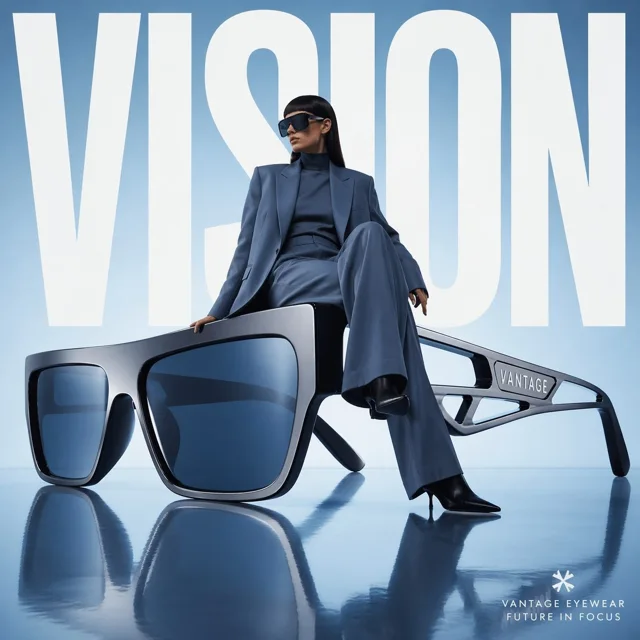
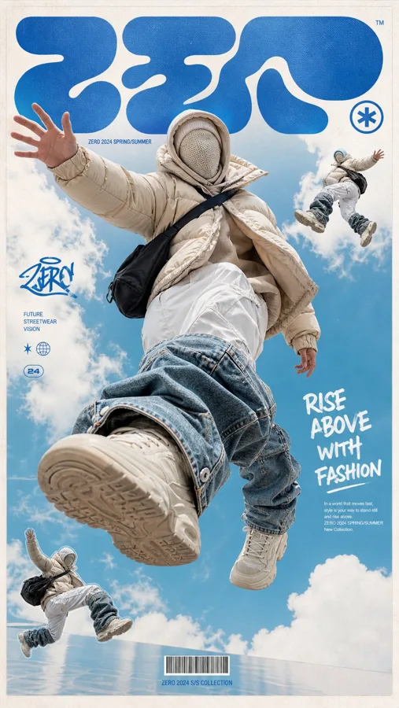
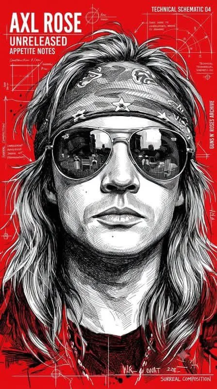
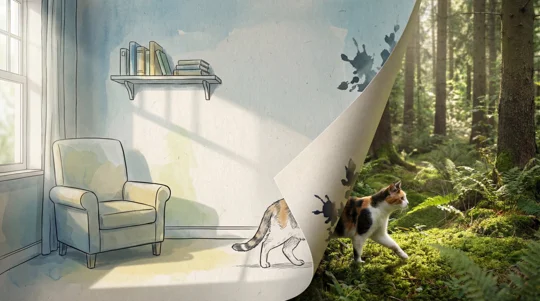
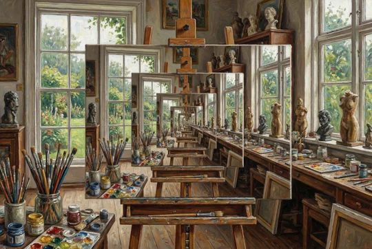
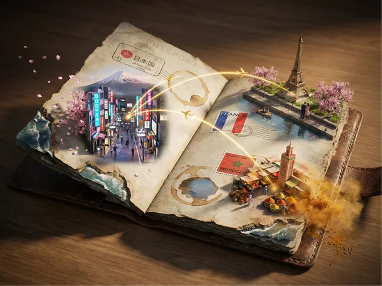
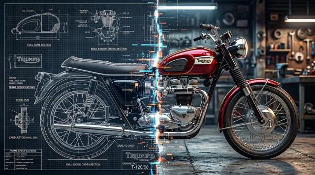
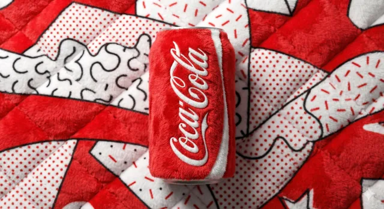

<div align="center">

# ATLAS
### AI 影像灵感库 · SELECTED WORKS

**好作品，不止值得收藏。也值得找到它的创作者。**

[打开完整画廊 ↗](https://biletian.github.io/ai-visual-atlas-preview/) · [推荐作品](https://github.com/biletian/ai-visual-atlas-preview/issues/new?template=submit-work.yml) · [纠错 / 权利反馈](https://github.com/biletian/ai-visual-atlas-preview/issues/new?template=correction.yml)

<a href="https://biletian.github.io/ai-visual-atlas-preview/#work=2005299702015918358"></a>

**夜空中的立体彩色烟花** · [Alexandra Aisling · 原帖 ↗](https://x.com/AllaAisling/status/2005299702015918358)

</div>

> **这是收录作品展，不是 Atlas 的原创作品集。** 本页选展 25 组作品，来自 20 个作者或来源署名；点击图片查看作品与提示词，点击署名回到原始来源。视频以封面展示，点击后播放。

---

## 01 / 视觉先声
### 大字、强色与不按常理出牌的广告

<table>
<tr>
<td width="50%" valign="top"><a href="https://biletian.github.io/ai-visual-atlas-preview/#work=2049022501850915160"></a><br><strong>跃起的运动鞋广告</strong><br><sub>GPT Image 2</sub> · <a href="https://x.com/Ozayrr_irl/status/2049022501850915160">Ozair AI ↗</a></td>
<td width="50%" valign="top"><a href="https://biletian.github.io/ai-visual-atlas-preview/#work=2047700936605479334"></a><br><strong>把眼镜变成家具的时尚广告</strong><br><sub>GPT Image 2</sub> · <a href="https://x.com/AIwithSynthia/status/2047700936605479334">Synthia ↗</a></td>
</tr>
<tr>
<td width="50%" valign="top"><a href="https://biletian.github.io/ai-visual-atlas-preview/#work=2051482525256819193"></a><br><strong>漂浮天空的街头服装海报</strong><br><sub>未知（原帖仅注明ChatGPT）</sub> · <a href="https://x.com/ponyodong/status/2051482525256819193">波妞PONYO ↗</a></td>
<td width="50%" valign="top"><a href="https://biletian.github.io/ai-visual-atlas-preview/#work=2098087685348892674"></a><br><strong>红底钢笔线稿音乐杂志</strong><br><sub>Nano Banana Pro</sub> · <a href="https://x.com/HustleXR/status/2098087685348892674">Zayan ↗</a></td>
</tr>
<tr>
<td width="50%" valign="top"><a href="https://biletian.github.io/ai-visual-atlas-preview/#work=2056791983717503015"></a><br><strong>六十年代汽水广告重想</strong><br><sub>GPT Image 2</sub> · <a href="https://x.com/Goodmanprotocol/status/2056791983717503015">Saul Goodman ↗</a></td>
<td width="50%" valign="top"><a href="https://biletian.github.io/ai-visual-atlas-preview/#work=2026374679276216569"></a><br><strong>字母蒙版时尚编辑海报</strong><br><sub>Nano Banana Pro</sub> · <a href="https://x.com/Arminn_Ai/status/2026374679276216569">ΛRMIN ↗</a></td>
</tr>
</table>

## 02 / 现实之外
### 把城市卷进丝带，让世界从纸上长出来

<table>
<tr>
<td width="50%" valign="top"><a href="https://biletian.github.io/ai-visual-atlas-preview/#work=2005659825028649109"></a><br><strong>从羊皮纸升起的文明地图</strong><br><sub>Nano Banana</sub> · <a href="https://x.com/AllaAisling/status/2005659825028649109">Alexandra Aisling ↗</a></td>
<td width="50%" valign="top"><a href="https://biletian.github.io/ai-visual-atlas-preview/#work=2007087774248439879"></a><br><strong>丝带上的四座城市</strong><br><sub>Nano Banana</sub> · <a href="https://x.com/aleenaamiir/status/2007087774248439879">Aleena Amir ↗</a></td>
</tr>
<tr>
<td width="50%" valign="top"><a href="https://biletian.github.io/ai-visual-atlas-preview/#work=2003059524681466121"></a><br><strong>从纸墙走进真实森林</strong><br><sub>Nano Banana</sub> · <a href="https://x.com/umesh_ai/status/2003059524681466121">Umesh ↗</a></td>
<td width="50%" valign="top"><a href="https://biletian.github.io/ai-visual-atlas-preview/#work=1993709106075767222"></a><br><strong>无限嵌套的画室</strong><br><sub>Nano Banana</sub> · <a href="https://x.com/fofrAI/status/1993709106075767222">fofr ↗</a></td>
</tr>
<tr>
<td width="50%" valign="top"><a href="https://biletian.github.io/ai-visual-atlas-preview/#work=2013269718572965934"></a><br><strong>护照印章里的旅行世界</strong><br><sub>Nano Banana Pro</sub> · <a href="https://x.com/AllaAisling/status/2013269718572965934">Alexandra Aisling ↗</a></td>
<td width="50%" valign="top"><a href="https://biletian.github.io/ai-visual-atlas-preview/#work=2030420620232561024"></a><br><strong>蓝图与实体交错的半幅视觉</strong><br><sub>Nano Banana 2</sub> · <a href="https://x.com/GlennHasABeard/status/2030420620232561024">Glenn Williams ↗</a></td>
</tr>
</table>

## 03 / 材质实验
### 水、玻璃、纸、绒毛与烟墨，换一种形态

<table>
<tr>
<td width="50%" valign="top"><a href="https://biletian.github.io/ai-visual-atlas-preview/#work=recraft-v41pro-marine-earring"></a><br><strong>深海生物形态的树脂耳饰</strong><br><sub>Recraft V4.1 Pro</sub> · <a href="https://recraft.ai/blog/testing-recraft-v4-1-and-krea-2">Recraft 官方 ↗</a></td>
<td width="50%" valign="top"><a href="https://biletian.github.io/ai-visual-atlas-preview/#work=recraft-v4-caustics"></a><br><strong>暗室中的水纹焦散光</strong><br><sub>Recraft V4</sub> · <a href="https://recraft.ai/blog/prompt-engineering-guide">Anna Abdulina / Recraft ↗</a></td>
</tr>
<tr>
<td width="50%" valign="top"><a href="https://biletian.github.io/ai-visual-atlas-preview/#work=2022199501168038032"></a><br><strong>水果造型镂空纸包装</strong><br><sub>Nano Banana Pro</sub> · <a href="https://x.com/Arminn_Ai/status/2022199501168038032">ΛRMIN ↗</a></td>
<td width="50%" valign="top"><a href="https://biletian.github.io/ai-visual-atlas-preview/#work=2008753339966877924"></a><br><strong>孟菲斯波普毛绒饮料</strong><br><sub>Nano Banana Pro</sub> · <a href="https://x.com/aleenaamiir/status/2008753339966877924">Aleena Amir ↗</a></td>
</tr>
<tr>
<td width="50%" valign="top"><a href="https://biletian.github.io/ai-visual-atlas-preview/#work=2011108316882014431"></a><br><strong>液体字构成清爽饮料广告</strong><br><sub>Nano Banana Pro</sub> · <a href="https://x.com/Kerroudjm/status/2011108316882014431">Mo ↗</a></td>
<td width="50%" valign="top"><a href="https://biletian.github.io/ai-visual-atlas-preview/#work=2007661583246471621"></a><br><strong>羽毛烟墨消散人像</strong><br><sub>GPT Image 1.5</sub> · <a href="https://x.com/saniaspeaks_/status/2007661583246471621">𝗦𝗮𝗻𝗶𝗮 ↗</a></td>
</tr>
</table>

## 04 / 让画面发生
### 角色、动作、转场与短片里的想象力

<table>
<tr>
<td width="50%" valign="top"><a href="https://biletian.github.io/ai-visual-atlas-preview/#work=runway-gen45-fox"></a><br><strong>草帽狐狸的乡间摩托旅行</strong><br><sub>▶ 视频</sub> · <a href="https://runway.com/research/introducing-runway-gen-4.5">Runway 官方 ↗</a></td>
<td width="50%" valign="top"><a href="https://biletian.github.io/ai-visual-atlas-preview/#work=2097001707683119410"></a><br><strong>青粉色残影的动漫时装舞蹈</strong><br><sub>▶ 视频</sub> · <a href="https://x.com/aimikoda/status/2097001707683119410">Kōda ↗</a></td>
</tr>
<tr>
<td width="50%" valign="top"><a href="https://biletian.github.io/ai-visual-atlas-preview/#work=2095651474797641955"></a><br><strong>角色数字组装：线框、服装到最终形象</strong><br><sub>▶ 视频</sub> · <a href="https://x.com/aimikoda/status/2095651474797641955">Kōda ↗</a></td>
<td width="50%" valign="top"><a href="https://biletian.github.io/ai-visual-atlas-preview/#work=2117456171053596757"></a><br><strong>一笔水墨召出龙虎</strong><br><sub>▶ 视频</sub> · <a href="https://x.com/AyeshaEvie/status/2117456171053596757">Ayesha ↗</a></td>
</tr>
<tr>
<td width="50%" valign="top"><a href="https://biletian.github.io/ai-visual-atlas-preview/#work=2117300920866496661"></a><br><strong>午夜停靠的幽灵列车</strong><br><sub>▶ 视频</sub> · <a href="https://x.com/Hope_Ai01/status/2117300920866496661">Hope Ai ↗</a></td>
<td width="50%" valign="top"><a href="https://biletian.github.io/ai-visual-atlas-preview/#work=2094644333882540334"></a><br><strong>从泥土到餐桌：土豆变成薯片</strong><br><sub>▶ 视频</sub> · <a href="https://x.com/Fujimoto_hina/status/2094644333882540334">Aegon ↗</a></td>
</tr>
</table>

<div align="center">

### 这只是入口，更多作品在画廊里。

**[进入 Atlas，继续发现 ↗](https://biletian.github.io/ai-visual-atlas-preview/)**

按主题找方向 · 按模型看案例 · 阅读公开提示词 · 浏览组图和视频 · 收藏灵感 · 回到原作者

</div>

---

<details>
<summary><strong>关于 Atlas：功能、收录方式与参与</strong></summary>

## 在 Atlas 里能找到什么

| 想做的事 | 怎么浏览 |
| --- | --- |
| 寻找视觉方向 | 按创作主题浏览海报、品牌、产品、插画、建筑、材质与短片等作品 |
| 看不同模型的创作案例 | 按模型筛选；模型名称按来源记录，不把推荐模型写成原始模型 |
| 理解作品怎么做 | 查看作者公开的提示词、参考材料和来源；缺失内容不补造 |
| 查看系列与过程 | 在详情里切换组图或多段视频，再回到画廊继续浏览 |
| 保存感兴趣的作品 | 使用浏览器本地收藏；无需账号，不上传收藏记录 |
| 找回原作者 | 通过作者与原帖链接继续查看完整语境 |

**收录快照：2026-11-16 核验时，首页精选为 403 组。** 组图按一组计，不等于图片数量；后续数量以[在线画廊](https://biletian.github.io/ai-visual-atlas-preview/)为准。数据中的候选与历史归档不等于当前公开精选。

## 我们如何收录

**发现 → 去重 → 核对出处 → 检查媒体与提示词 → 精选展示 → 持续纠错**

- 优先有原始发布记录、明确作者和可核对媒体的作品，兼顾不同作者、模型与视觉方向。
- 保留完整提示词、模板、摘录或未公开等实际状态；需要参考图的案例注明前提，不承诺一键复现。
- 模型、日期与创作说明依据来源记录，创作者的说法不等于本站独立测评结论。
- 尊重原作者的转载限制，不收录明确禁止转载的作品；开放许可按其条件保留署名和声明。
- 图片和视频中的品牌、人物与场景属于作品内容，不代表 Atlas 的合作、背书或真实事件记录。

发现错误或希望调整展示？请使用[纠错与权利反馈](https://github.com/biletian/ai-visual-atlas-preview/issues/new?template=correction.yml)。请只填写必要的公开信息，不在公开 Issue 上传证件、私人联系方式或其他敏感资料。

## 参与整理

欢迎推荐自己的作品或有清晰出处的优秀案例，也欢迎修正作者、模型、提示词和失效链接。

1. 通过[作品推荐表单](https://github.com/biletian/ai-visual-atlas-preview/issues/new?template=submit-work.yml)提供原帖、作者、模型及公开提示词。
2. 说明你与作品的关系和展示许可；推荐不代表自动收录。
3. 代码或数据修改请先阅读 [CONTRIBUTING.md](CONTRIBUTING.md)，保持原始来源及许可信息。


</details>

<details>
<summary><strong>开发与维护：本地运行、验证和部署</strong></summary>

## 本地运行

网站使用原生 HTML / CSS / JavaScript。运行已生成的静态文件无需前端打包器；从仓库重建完整公开目录需要 Python、Node.js 与 Pillow，且媒体核验会访问来源或已有发布副本。

```sh
python -m pip install Pillow==13.0.0
python scripts/build-curation.py
python scripts/sync-data.py
python scripts/build-catalog.py
python -m http.server 8080 --directory dist
```

打开 `http://localhost:8080`。`dist/cases.json` 只是基底，公开内容还由 `scripts/content-batch*.json` 等批次文件扩展，不能只编辑或统计基底后声称已更新全站。


```text
dist/                   静态网站、基底数据与已存媒体
scripts/                内容/媒体批次、重建与验证脚本
docs/                   核验记录、交互与构建说明
tests/                  分类、组图、视频、链接等检查
.github/workflows/      GitHub Pages 发布流程
```

```sh
node --check dist/app.js
node --check dist/ui.js
node scripts/verify-gallery.cjs
node tests/avatar.cjs
node tests/image-gallery.cjs
```

`main` 更新触发 [Deploy Visual Atlas](.github/workflows/pages.yml)：重建并核验媒体与目录，通过后发布 `dist/`。详情参考[内容构建](docs/content-build.md)、[组图说明](docs/image-gallery.md)与[组件和动效](docs/components-motion.md)。

列表采用增量加载，完整提示词和组图详情按需加载；视频减少离屏预加载，切后台暂停。实际访问速度仍受网络与第三方来源影响。


</details>

## 来源、许可与隐私

- **收录不等于授权再分发。** 作品、提示词、头像与商标分别遵循原权利人的许可或限制。公开可访问、附带原帖链接或标记为可展示，不等于获得开放许可证或商用授权。
- `owner-directed-display` 是项目内的展示记录，不是作者授予的开放许可。使用作品前请回到原始来源核对条款，必要时联系原作者。
- CC BY 4.0 素材保留署名、来源、许可及转码说明，见 [ailingqu 署名](dist/assets/ailingqu/ATTRIBUTION.txt)与[许可](dist/assets/ailingqu/LICENSE)。转码和缩略图不改变原始权属。
- 图标与历史集成依赖分别见 [LUCIDE-LICENSE](LUCIDE-LICENSE) 和 [HEROUI-LICENSE](HEROUI-LICENSE)。这些第三方许可证**不代表整个作品库统一采用同一许可证**。
- 收藏仅保存在当前浏览器。第三方媒体与原帖请求可能受到网络限制；跳转后的站点适用其自身规则。

## English

**Atlas is a curated collection of AI-generated images and videos, not an original portfolio or an image-generation service.** Explore works by theme or model, inspect publicly shared prompts and references, and follow the credits back to the original creators.

The gallery includes images, animations, image sets and video examples. Availability of a prompt does not guarantee identical results. Attribution does not grant reuse rights: each work keeps its original license or restrictions.

[Explore the gallery](https://biletian.github.io/ai-visual-atlas-preview/) · [Contribute a work](CONTRIBUTING.md) · [Report a correction](https://github.com/biletian/ai-visual-atlas-preview/issues/new?template=correction.yml)


<div align="center">

[](https://github.com/biletian/ai-visual-atlas-preview/actions/workflows/pages.yml)
[](https://github.com/biletian/ai-visual-atlas-preview/stargazers)
[](https://github.com/biletian/ai-visual-atlas-preview/commits/main/)

<sub>作品属于创作者。Atlas 让发现它们更容易。</sub>

</div>
