<div align="center">

<a href="https://biletian.github.io/ai-visual-atlas-preview/">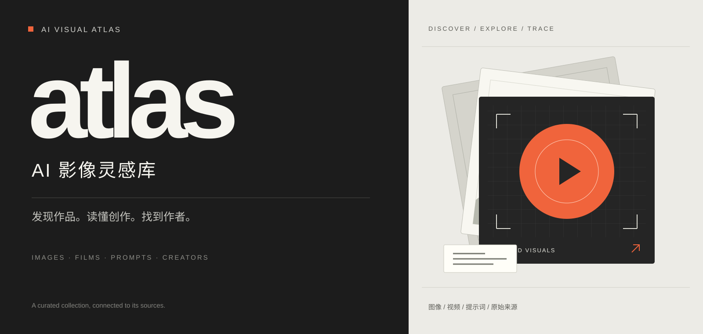</a>

# Atlas · AI 影像灵感库

**发现作品。读懂创作。找到作者。**

[打开完整画廊 ↗](https://biletian.github.io/ai-visual-atlas-preview/) · [推荐作品](https://github.com/biletian/ai-visual-atlas-preview/issues/new?template=submit-work.yml) · [纠错 / 权利反馈](https://github.com/biletian/ai-visual-atlas-preview/issues/new?template=correction.yml)

</div>

> **这是收录作品展，不是 Atlas 的原创作品集。** 本页选展 25 组作品，来自 20 个作者或来源署名；点击图片查看作品与提示词，点击署名回到原始来源。视频以封面展示，点击后播放。


## 收录作品 · 本期焦点

<a href="https://biletian.github.io/ai-visual-atlas-preview/#work=2005299702015918358"></a>

**夜空中的立体彩色烟花** · [Alexandra Aisling · 原帖 ↗](https://x.com/AllaAisling/status/2005299702015918358)


---

## 01 / 视觉先声
### 大字、强色与不按常理出牌的广告

<table>
<tr>
<td width="50%" valign="top"><a href="https://biletian.github.io/ai-visual-atlas-preview/#work=2049022501850915160">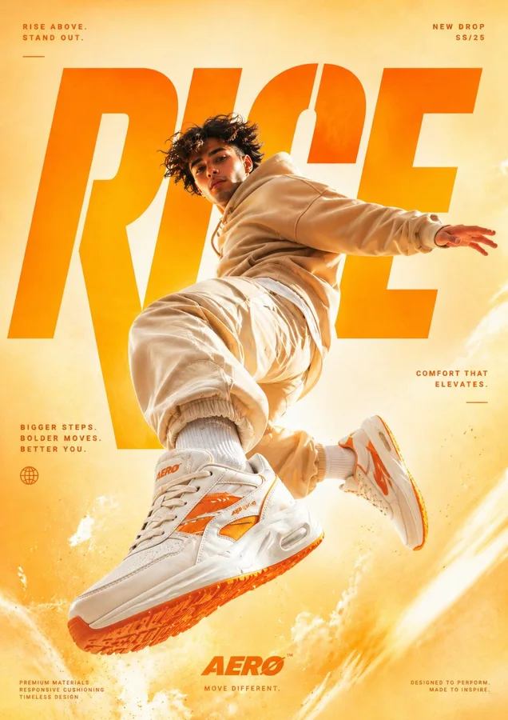</a><br><strong>跃起的运动鞋广告</strong><br><sub>GPT Image 2</sub> · <a href="https://x.com/Ozayrr_irl/status/2049022501850915160">Ozair AI ↗</a></td>
<td width="50%" valign="top"><a href="https://biletian.github.io/ai-visual-atlas-preview/#work=2047700936605479334"></a><br><strong>把眼镜变成家具的时尚广告</strong><br><sub>GPT Image 2</sub> · <a href="https://x.com/AIwithSynthia/status/2047700936605479334">Synthia ↗</a></td>
</tr>
<tr>
<td width="50%" valign="top"><a href="https://biletian.github.io/ai-visual-atlas-preview/#work=2051482525256819193"></a><br><strong>漂浮天空的街头服装海报</strong><br><sub>未知（原帖仅注明ChatGPT）</sub> · <a href="https://x.com/ponyodong/status/2051482525256819193">波妞PONYO ↗</a></td>
<td width="50%" valign="top"><a href="https://biletian.github.io/ai-visual-atlas-preview/#work=2098087685348892674"></a><br><strong>红底钢笔线稿音乐杂志</strong><br><sub>Nano Banana Pro</sub> · <a href="https://x.com/HustleXR/status/2098087685348892674">Zayan ↗</a></td>
</tr>
<tr>
<td width="50%" valign="top"><a href="https://biletian.github.io/ai-visual-atlas-preview/#work=2056791983717503015">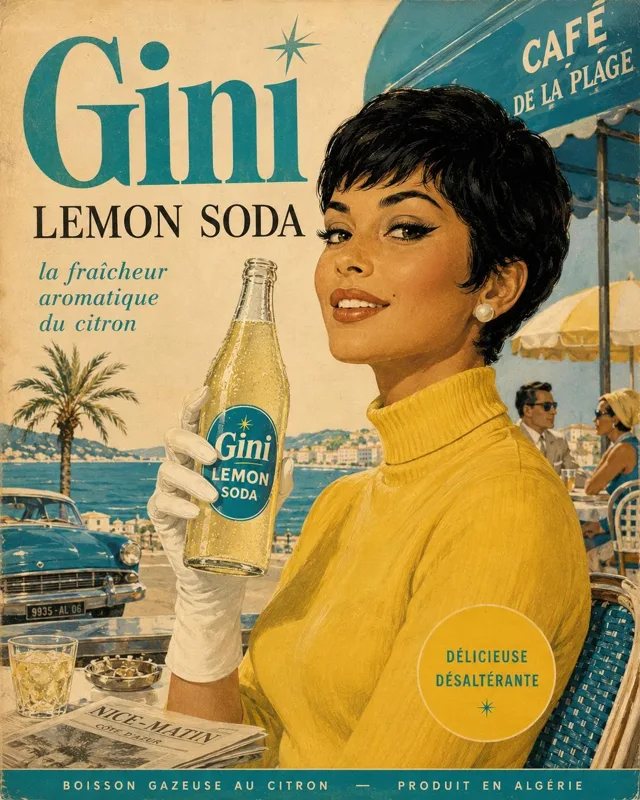</a><br><strong>六十年代汽水广告重想</strong><br><sub>GPT Image 2</sub> · <a href="https://x.com/Goodmanprotocol/status/2056791983717503015">Saul Goodman ↗</a></td>
<td width="50%" valign="top"><a href="https://biletian.github.io/ai-visual-atlas-preview/#work=2026374679276216569">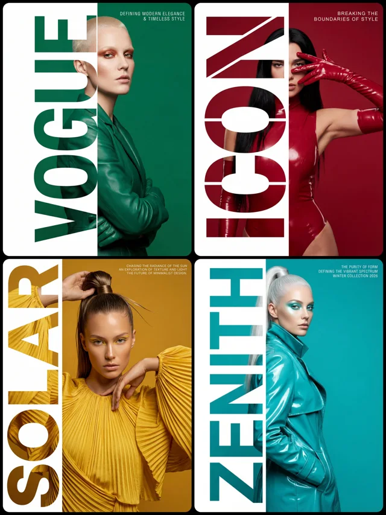</a><br><strong>字母蒙版时尚编辑海报</strong><br><sub>Nano Banana Pro</sub> · <a href="https://x.com/Arminn_Ai/status/2026374679276216569">ΛRMIN ↗</a></td>
</tr>
</table>

## 02 / 现实之外
### 把城市卷进丝带，让世界从纸上长出来

<table>
<tr>
<td width="50%" valign="top"><a href="https://biletian.github.io/ai-visual-atlas-preview/#work=2005659825028649109">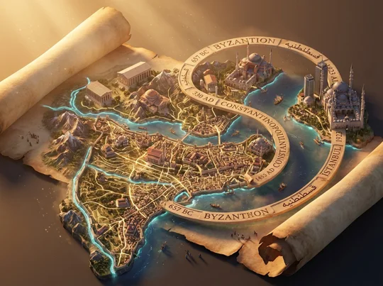</a><br><strong>从羊皮纸升起的文明地图</strong><br><sub>Nano Banana</sub> · <a href="https://x.com/AllaAisling/status/2005659825028649109">Alexandra Aisling ↗</a></td>
<td width="50%" valign="top"><a href="https://biletian.github.io/ai-visual-atlas-preview/#work=2007087774248439879">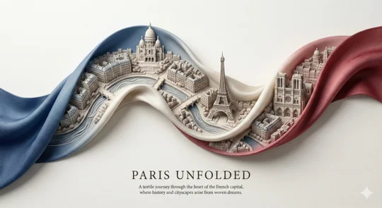</a><br><strong>丝带上的四座城市</strong><br><sub>Nano Banana</sub> · <a href="https://x.com/aleenaamiir/status/2007087774248439879">Aleena Amir ↗</a></td>
</tr>
<tr>
<td width="50%" valign="top"><a href="https://biletian.github.io/ai-visual-atlas-preview/#work=2003059524681466121"></a><br><strong>从纸墙走进真实森林</strong><br><sub>Nano Banana</sub> · <a href="https://x.com/umesh_ai/status/2003059524681466121">Umesh ↗</a></td>
<td width="50%" valign="top"><a href="https://biletian.github.io/ai-visual-atlas-preview/#work=1993709106075767222"></a><br><strong>无限嵌套的画室</strong><br><sub>Nano Banana</sub> · <a href="https://x.com/fofrAI/status/1993709106075767222">fofr ↗</a></td>
</tr>
<tr>
<td width="50%" valign="top"><a href="https://biletian.github.io/ai-visual-atlas-preview/#work=2013269718572965934"></a><br><strong>护照印章里的旅行世界</strong><br><sub>Nano Banana Pro</sub> · <a href="https://x.com/AllaAisling/status/2013269718572965934">Alexandra Aisling ↗</a></td>
<td width="50%" valign="top"><a href="https://biletian.github.io/ai-visual-atlas-preview/#work=2030420620232561024"></a><br><strong>蓝图与实体交错的半幅视觉</strong><br><sub>Nano Banana 2</sub> · <a href="https://x.com/GlennHasABeard/status/2030420620232561024">Glenn Williams ↗</a></td>
</tr>
</table>

## 03 / 材质实验
### 水、玻璃、纸、绒毛与烟墨，换一种形态

<table>
<tr>
<td width="50%" valign="top"><a href="https://biletian.github.io/ai-visual-atlas-preview/#work=recraft-v41pro-marine-earring">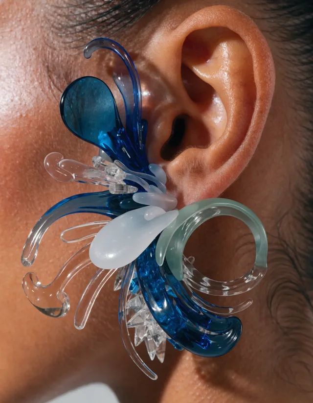</a><br><strong>深海生物形态的树脂耳饰</strong><br><sub>Recraft V4.1 Pro</sub> · <a href="https://recraft.ai/blog/testing-recraft-v4-1-and-krea-2">Recraft 官方 ↗</a></td>
<td width="50%" valign="top"><a href="https://biletian.github.io/ai-visual-atlas-preview/#work=recraft-v4-caustics">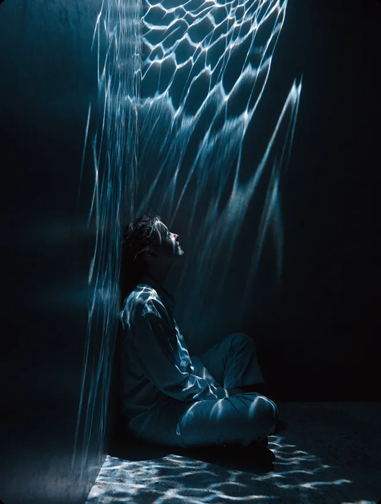</a><br><strong>暗室中的水纹焦散光</strong><br><sub>Recraft V4</sub> · <a href="https://recraft.ai/blog/prompt-engineering-guide">Anna Abdulina / Recraft ↗</a></td>
</tr>
<tr>
<td width="50%" valign="top"><a href="https://biletian.github.io/ai-visual-atlas-preview/#work=2022199501168038032">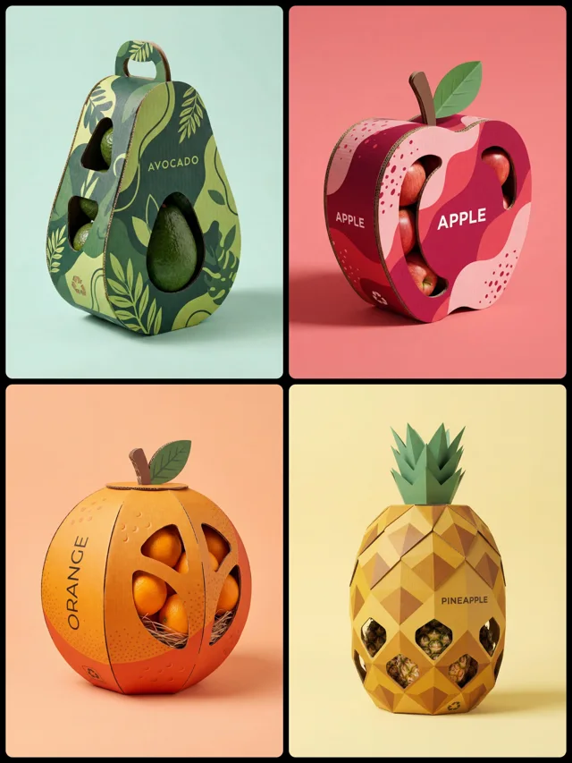</a><br><strong>水果造型镂空纸包装</strong><br><sub>Nano Banana Pro</sub> · <a href="https://x.com/Arminn_Ai/status/2022199501168038032">ΛRMIN ↗</a></td>
<td width="50%" valign="top"><a href="https://biletian.github.io/ai-visual-atlas-preview/#work=2008753339966877924"></a><br><strong>孟菲斯波普毛绒饮料</strong><br><sub>Nano Banana Pro</sub> · <a href="https://x.com/aleenaamiir/status/2008753339966877924">Aleena Amir ↗</a></td>
</tr>
<tr>
<td width="50%" valign="top"><a href="https://biletian.github.io/ai-visual-atlas-preview/#work=2011108316882014431">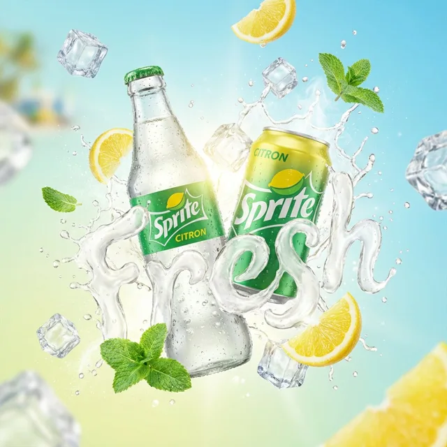</a><br><strong>液体字构成清爽饮料广告</strong><br><sub>Nano Banana Pro</sub> · <a href="https://x.com/Kerroudjm/status/2011108316882014431">Mo ↗</a></td>
<td width="50%" valign="top"><a href="https://biletian.github.io/ai-visual-atlas-preview/#work=2007661583246471621">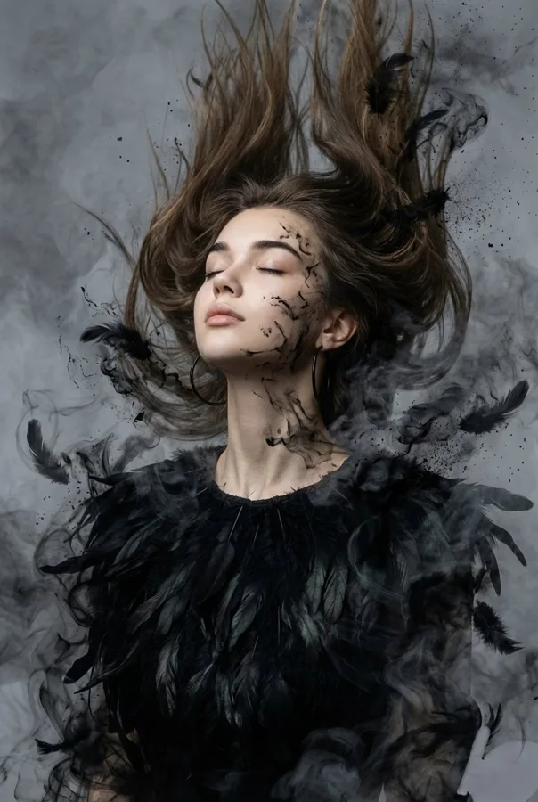</a><br><strong>羽毛烟墨消散人像</strong><br><sub>GPT Image 1.5</sub> · <a href="https://x.com/saniaspeaks_/status/2007661583246471621">𝗦𝗮𝗻𝗶𝗮 ↗</a></td>
</tr>
</table>

## 04 / 让画面发生
### 角色、动作、转场与短片里的想象力

<table>
<tr>
<td width="50%" valign="top"><a href="https://biletian.github.io/ai-visual-atlas-preview/#work=runway-gen45-fox"></a><br><strong>草帽狐狸的乡间摩托旅行</strong><br><sub>▶ 视频</sub> · <a href="https://runway.com/research/introducing-runway-gen-4.5">Runway 官方 ↗</a></td>
<td width="50%" valign="top"><a href="https://biletian.github.io/ai-visual-atlas-preview/#work=2097001707683119410"></a><br><strong>青粉色残影的动漫时装舞蹈</strong><br><sub>▶ 视频</sub> · <a href="https://x.com/aimikoda/status/2097001707683119410">Kōda ↗</a></td>
</tr>
<tr>
<td width="50%" valign="top"><a href="https://biletian.github.io/ai-visual-atlas-preview/#work=2095651474797641955">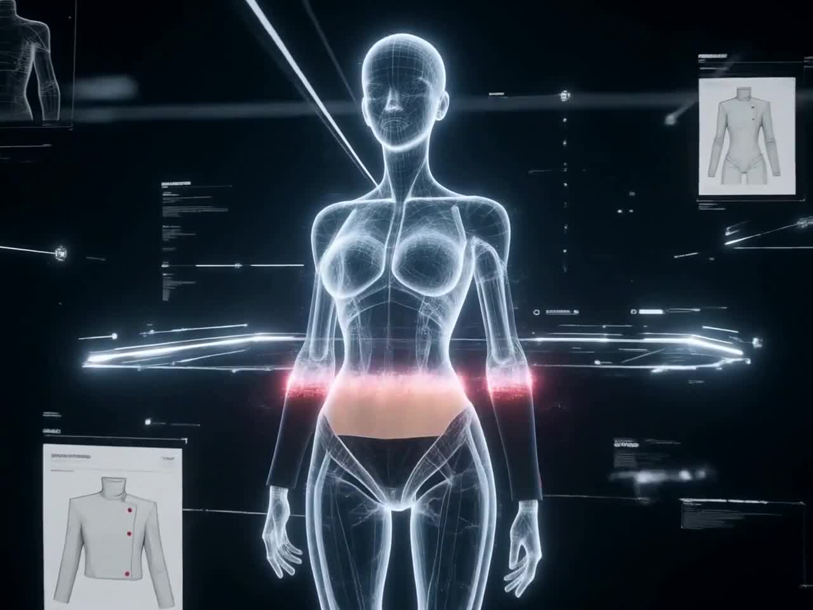</a><br><strong>角色数字组装：线框、服装到最终形象</strong><br><sub>▶ 视频</sub> · <a href="https://x.com/aimikoda/status/2095651474797641955">Kōda ↗</a></td>
<td width="50%" valign="top"><a href="https://biletian.github.io/ai-visual-atlas-preview/#work=2117456171053596757">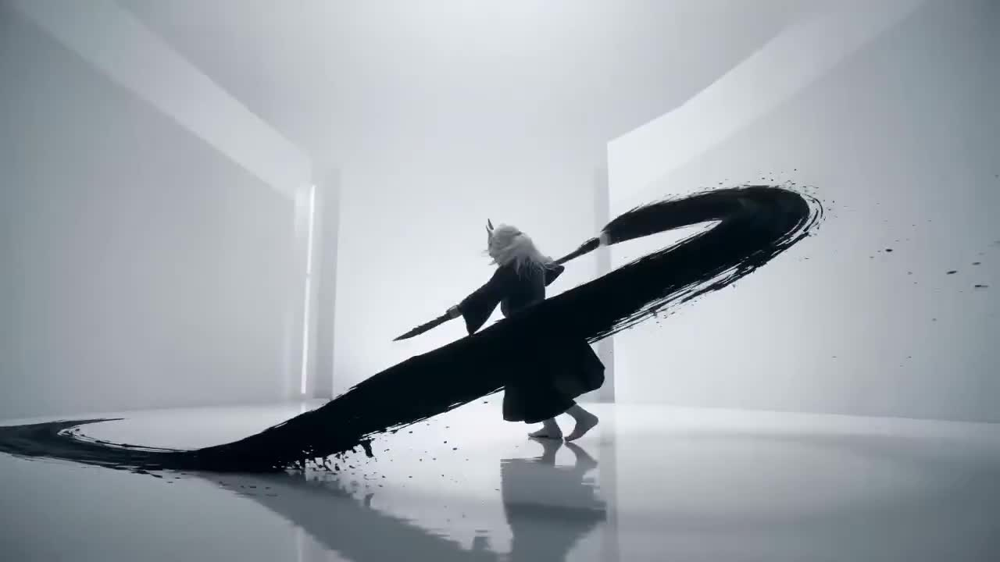</a><br><strong>一笔水墨召出龙虎</strong><br><sub>▶ 视频</sub> · <a href="https://x.com/AyeshaEvie/status/2117456171053596757">Ayesha ↗</a></td>
</tr>
<tr>
<td width="50%" valign="top"><a href="https://biletian.github.io/ai-visual-atlas-preview/#work=2117300920866496661">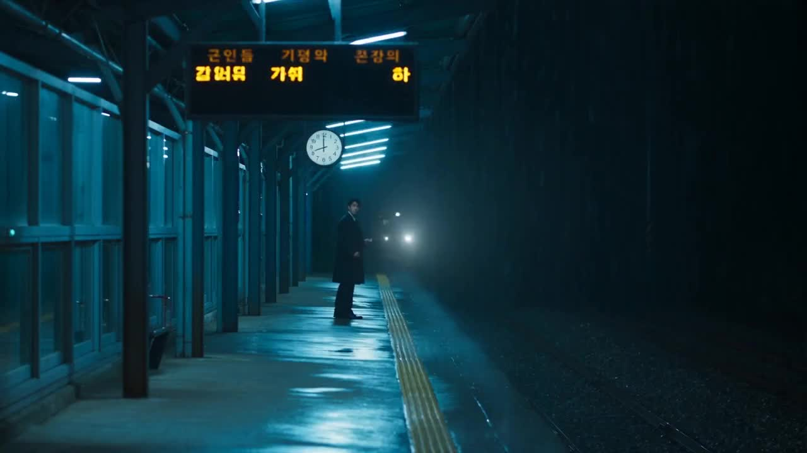</a><br><strong>午夜停靠的幽灵列车</strong><br><sub>▶ 视频</sub> · <a href="https://x.com/Hope_Ai01/status/2117300920866496661">Hope Ai ↗</a></td>
<td width="50%" valign="top"><a href="https://biletian.github.io/ai-visual-atlas-preview/#work=2094644333882540334">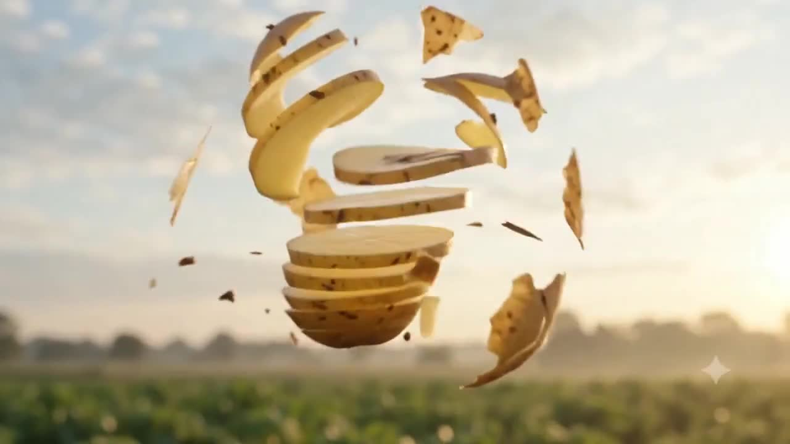</a><br><strong>从泥土到餐桌：土豆变成薯片</strong><br><sub>▶ 视频</sub> · <a href="https://x.com/Fujimoto_hina/status/2094644333882540334">Aegon ↗</a></td>
</tr>
</table>

<div align="center">

### 这只是入口，更多作品在画廊里。

**[进入 Atlas，继续发现 ↗](https://biletian.github.io/ai-visual-atlas-preview/)**

按主题找方向 · 按模型看案例 · 阅读公开提示词 · 浏览组图和视频 · 收藏灵感 · 回到原作者

</div>

---

## 收录总览 · 分类与作品一起看

**405 组精选 · 34 个主分类**

统计快照：**2026-11-16**。只统计当前线上精选清单与公开目录匹配的作品，一组组图或多段视频计 1 组；每组只有一个主分类，因此下表不重复计数，合计 **405**。保留站内实际分类名称，未把名称相近的分类擅自合并。数量会随更新变化，以[在线画廊](https://biletian.github.io/ai-visual-atlas-preview/)为准。

<table>
<tr><th>分类</th><th>收录数量</th><th>作品示例 · 点击图片查看详情</th></tr>
<tr><td><strong>插画与角色</strong></td><td align="center">65 组</td><td><a href="https://biletian.github.io/ai-visual-atlas-preview/#work=recraft-v4-crimson-icons">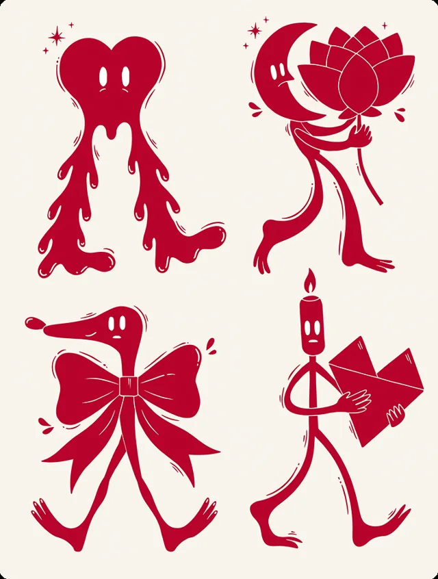</a><br><strong>四个酒红色超现实角色图标</strong><br><a href="https://recraft.ai/blog/prompt-engineering-guide">Anna Abdulina / Recraft · 原始来源 ↗</a></td></tr>
<tr><td><strong>品牌与广告</strong></td><td align="center">40 组</td><td><a href="https://biletian.github.io/ai-visual-atlas-preview/#work=2049022501850915160"></a><br><strong>跃起的运动鞋广告</strong><br><a href="https://x.com/Ozayrr_irl/status/2049022501850915160">Ozair AI · 原始来源 ↗</a></td></tr>
<tr><td><strong>海报与排版</strong></td><td align="center">39 组</td><td><a href="https://biletian.github.io/ai-visual-atlas-preview/#work=2051482525256819193"></a><br><strong>漂浮天空的街头服装海报</strong><br><a href="https://x.com/ponyodong/status/2051482525256819193">波妞PONYO · 原始来源 ↗</a></td></tr>
<tr><td><strong>短片与镜头</strong></td><td align="center">35 组</td><td><a href="https://biletian.github.io/ai-visual-atlas-preview/#work=runway-gen45-fox"></a><br><strong>草帽狐狸的乡间摩托旅行</strong><br><a href="https://runway.com/research/introducing-runway-gen-4.5">Runway 官方 · 原始来源 ↗</a></td></tr>
<tr><td><strong>微缩与超现实</strong></td><td align="center">28 组</td><td><a href="https://biletian.github.io/ai-visual-atlas-preview/#work=2005299702015918358"></a><br><strong>夜空中的立体彩色烟花</strong><br><a href="https://x.com/AllaAisling/status/2005299702015918358">Alexandra Aisling · 原始来源 ↗</a></td></tr>
<tr><td><strong>信息图</strong></td><td align="center">25 组</td><td><a href="https://biletian.github.io/ai-visual-atlas-preview/#work=2003849647392247864">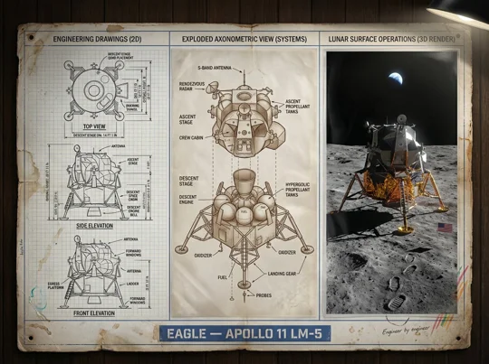</a><br><strong>从工程图到电影感展板</strong><br><a href="https://x.com/AllaAisling/status/2003849647392247864">Alexandra Aisling · 原始来源 ↗</a></td></tr>
<tr><td><strong>产品与电商</strong></td><td align="center">21 组</td><td><a href="https://biletian.github.io/ai-visual-atlas-preview/#work=2010275488703381858">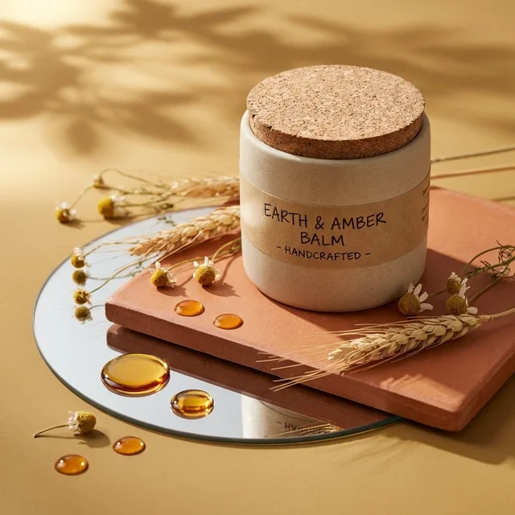</a><br><strong>镜面石台与自然护肤静物</strong><br><a href="https://x.com/Kerroudjm/status/2010275488703381858">Mo · 原始来源 ↗</a></td></tr>
<tr><td><strong>品牌与平面设计</strong></td><td align="center">17 组</td><td><a href="https://biletian.github.io/ai-visual-atlas-preview/#work=2012178722615329176">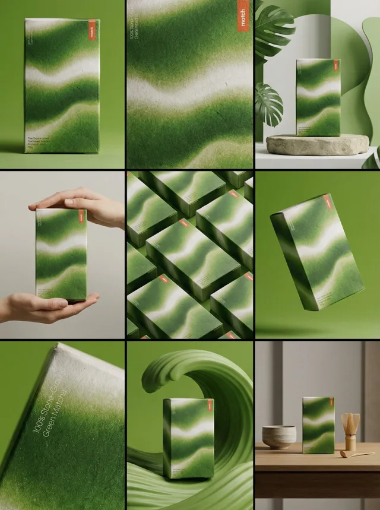</a><br><strong>产品品牌九格视觉分镜</strong><br><a href="https://x.com/Dari_Designs/status/2012178722615329176">Daria_Surkova · 原始来源 ↗</a></td></tr>
<tr><td><strong>材质与工艺</strong></td><td align="center">16 组</td><td><a href="https://biletian.github.io/ai-visual-atlas-preview/#work=recraft-v41pro-marine-earring"></a><br><strong>深海生物形态的树脂耳饰</strong><br><a href="https://recraft.ai/blog/testing-recraft-v4-1-and-krea-2">Recraft 官方 · 原始来源 ↗</a></td></tr>
<tr><td><strong>建筑与空间</strong></td><td align="center">16 组</td><td><a href="https://biletian.github.io/ai-visual-atlas-preview/#work=2007031565277155334">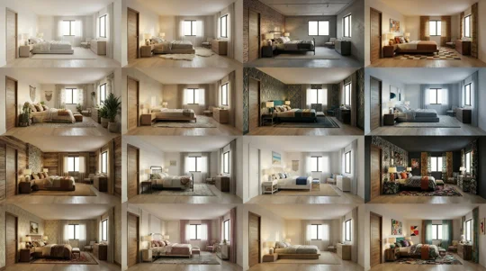</a><br><strong>同一空间的16种装修风格</strong><br><a href="https://x.com/gokayfem/status/2007031565277155334">gokaygokay · 原始来源 ↗</a></td></tr>
<tr><td><strong>摄影与人像</strong></td><td align="center">16 组</td><td><a href="https://biletian.github.io/ai-visual-atlas-preview/#work=recraft-v4-caustics"></a><br><strong>暗室中的水纹焦散光</strong><br><a href="https://recraft.ai/blog/prompt-engineering-guide">Anna Abdulina / Recraft · 原始来源 ↗</a></td></tr>
<tr><td><strong>旅行与城市</strong></td><td align="center">14 组</td><td><a href="https://biletian.github.io/ai-visual-atlas-preview/#work=2007087774248439879"></a><br><strong>丝带上的四座城市</strong><br><a href="https://x.com/aleenaamiir/status/2007087774248439879">Aleena Amir · 原始来源 ↗</a></td></tr>
<tr><td><strong>产品与界面设计</strong></td><td align="center">13 组</td><td><a href="https://biletian.github.io/ai-visual-atlas-preview/#work=2030420620232561024"></a><br><strong>蓝图与实体交错的半幅视觉</strong><br><a href="https://x.com/GlennHasABeard/status/2030420620232561024">Glenn Williams · 原始来源 ↗</a></td></tr>
<tr><td><strong>图像编辑</strong></td><td align="center">10 组</td><td><a href="https://biletian.github.io/ai-visual-atlas-preview/#work=2049538141993001161">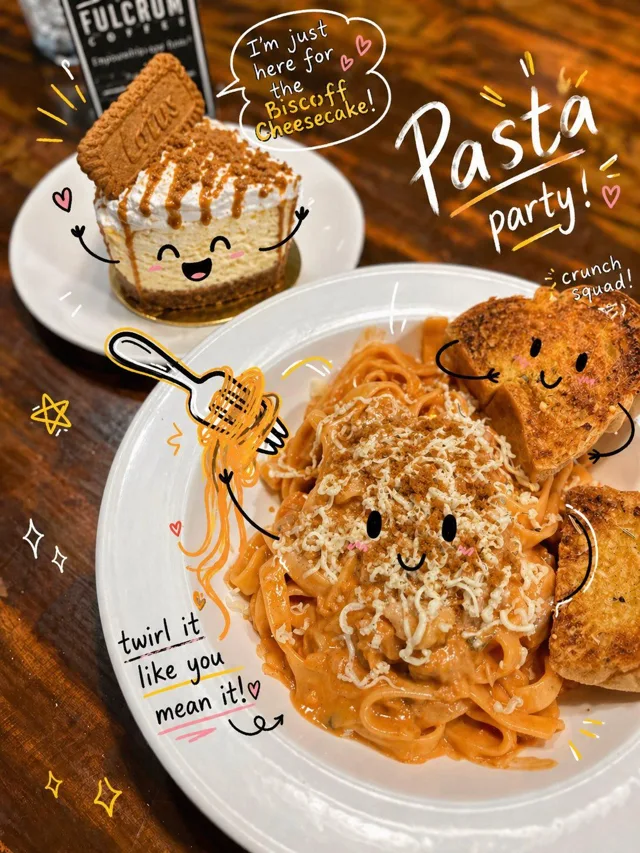</a><br><strong>给食物照片加上互动涂鸦</strong><br><a href="https://x.com/oggii_0/status/2049538141993001161">Oogie · 原始来源 ↗</a></td></tr>
<tr><td><strong>分镜与叙事设计</strong></td><td align="center">8 组</td><td><a href="https://biletian.github.io/ai-visual-atlas-preview/#work=2076572186220155024">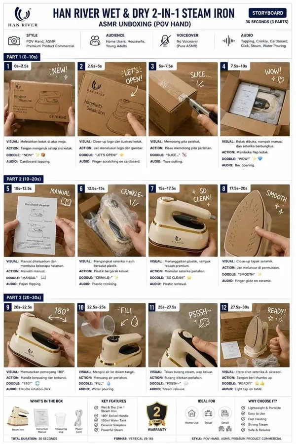</a><br><strong>把产品开箱拆成十二格广告分镜</strong><br><a href="https://x.com/Ziha_ai/status/2076572186220155024">Ziha · 原始来源 ↗</a></td></tr>
<tr><td><strong>创意短片</strong></td><td align="center">5 组</td><td><a href="https://biletian.github.io/ai-visual-atlas-preview/#work=2029019321364824452">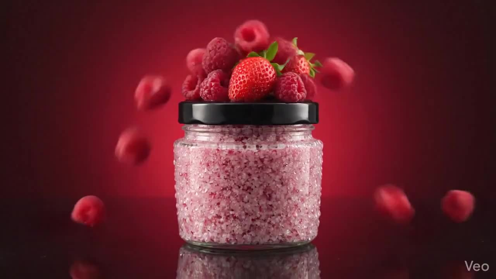</a><br><strong>莓果护肤品自动组装广告</strong><br><a href="https://x.com/ChillaiKalan__/status/2029019321364824452">K · 原始来源 ↗</a></td></tr>
<tr><td><strong>游戏美术</strong></td><td align="center">4 组</td><td><a href="https://biletian.github.io/ai-visual-atlas-preview/#work=1992598016868720997">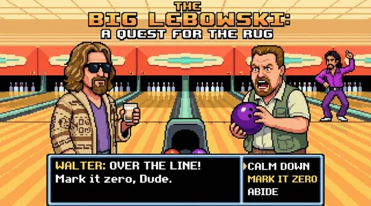</a><br><strong>把电影变成像素游戏</strong><br><a href="https://x.com/icreatelife/status/1992598016868720997">Kris Kashtanova · 原始来源 ↗</a></td></tr>
<tr><td><strong>动图与动画</strong></td><td align="center">4 组</td><td><a href="https://biletian.github.io/ai-visual-atlas-preview/#work=2118135343354720648">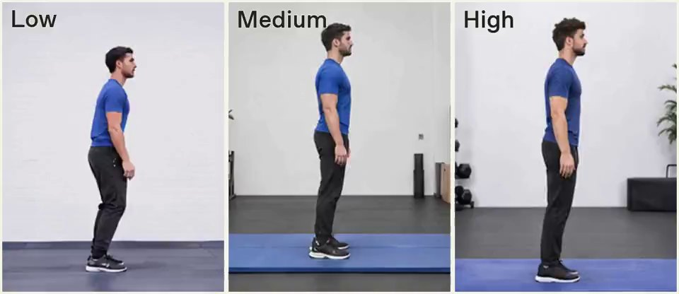</a><br><strong>原地后空翻 GIF</strong><br><a href="https://x.com/gabrielchua/status/2118135343354720648">Gabriel Chua · 原始来源 ↗</a></td></tr>
<tr><td><strong>字体与文字设计</strong></td><td align="center">3 组</td><td><a href="https://biletian.github.io/ai-visual-atlas-preview/#work=2011108316882014431"></a><br><strong>液体字构成清爽饮料广告</strong><br><a href="https://x.com/Kerroudjm/status/2011108316882014431">Mo · 原始来源 ↗</a></td></tr>
<tr><td><strong>摄影对比</strong></td><td align="center">3 组</td><td><a href="https://biletian.github.io/ai-visual-atlas-preview/#work=2120189335194706023">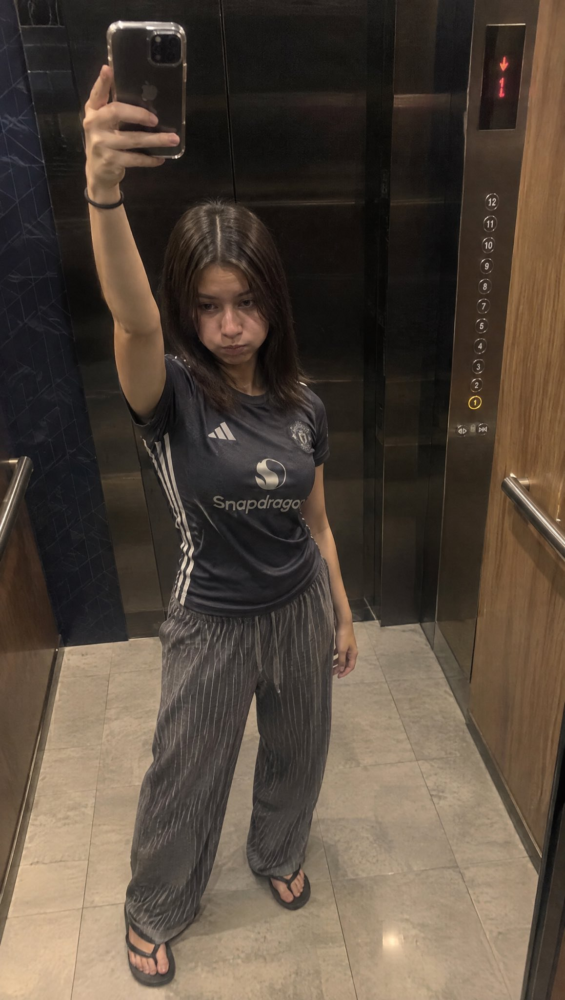</a><br><strong>电梯镜面自拍对比</strong><br><a href="https://x.com/simonecanciello/status/2120189335194706023">Simone Canc · 原始来源 ↗</a></td></tr>
<tr><td><strong>时装与拼贴</strong></td><td align="center">3 组</td><td><a href="https://biletian.github.io/ai-visual-atlas-preview/#work=2120192333148987761">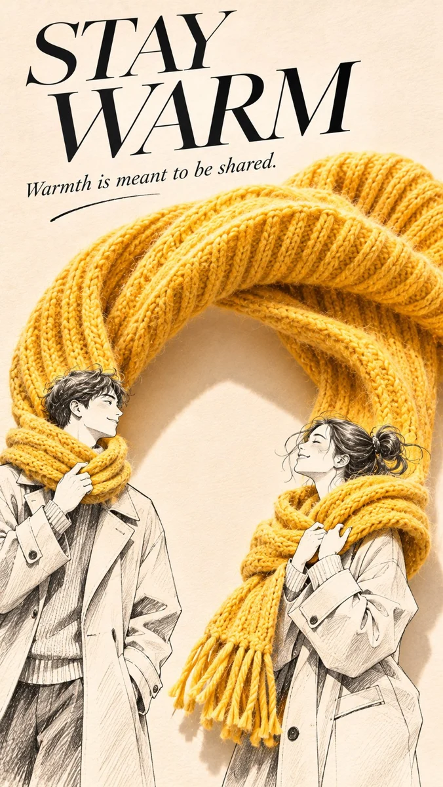</a><br><strong>围巾里的冬日时装</strong><br><a href="https://x.com/MrLarus/status/2120192333148987761">Larus Canus · 原始来源 ↗</a></td></tr>
<tr><td><strong>角色与概念设计</strong></td><td align="center">3 组</td><td><a href="https://biletian.github.io/ai-visual-atlas-preview/#work=2056372978607174077"></a><br><strong>天体旅人的四视图设定</strong><br><a href="https://x.com/0kncn/status/2056372978607174077">Okan Can · 原始来源 ↗</a></td></tr>
<tr><td><strong>氛围循环动画</strong></td><td align="center">3 组</td><td><a href="https://biletian.github.io/ai-visual-atlas-preview/#work=2118308538564989025-1"></a><br><strong>水粉旅行海报·金门大桥</strong><br><a href="https://x.com/devteamdrew/status/2118308538564989025">DreW · 原始来源 ↗</a></td></tr>
<tr><td><strong>视频工作流</strong></td><td align="center">2 组</td><td><a href="https://biletian.github.io/ai-visual-atlas-preview/#work=2118408795026043260">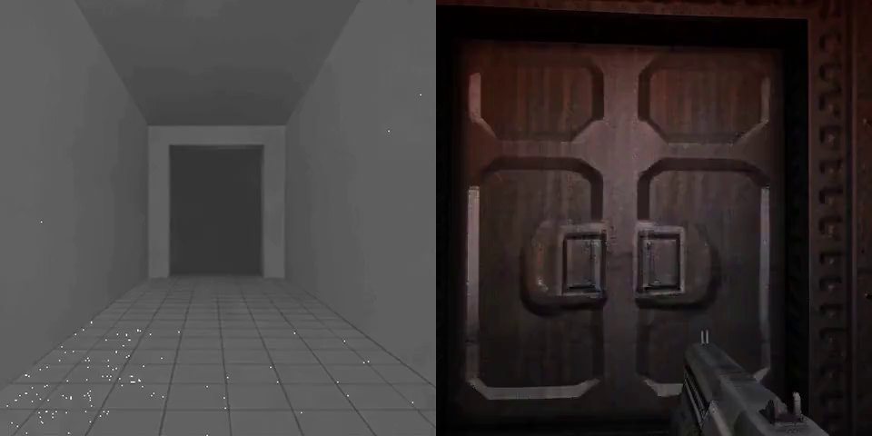</a><br><strong>灰模 GIF 转游戏镜头</strong><br><a href="https://x.com/cocktailpeanut/status/2118408795026043260">cocktail peanut · 原始来源 ↗</a></td></tr>
<tr><td><strong>像素动画</strong></td><td align="center">2 组</td><td><a href="https://biletian.github.io/ai-visual-atlas-preview/#work=2118670168415182931">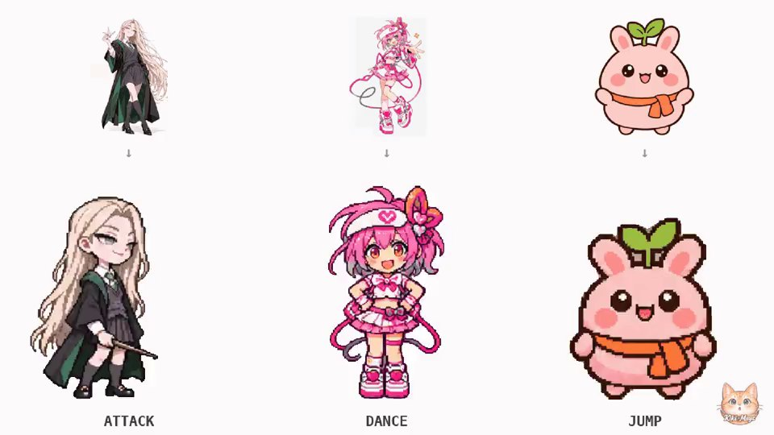</a><br><strong>角色转像素动画动作集</strong><br><a href="https://x.com/Mayz1169/status/2118670168415182931">Kiki · 原始来源 ↗</a></td></tr>
<tr><td><strong>角色与插画</strong></td><td align="center">2 组</td><td><a href="https://biletian.github.io/ai-visual-atlas-preview/#work=2048251738604613725"></a><br><strong>温柔手帐风角色设定卡</strong><br><a href="https://x.com/ZaraIrahh/status/2048251738604613725">Zara · 原始来源 ↗</a></td></tr>
<tr><td><strong>时尚与穿搭</strong></td><td align="center">1 组</td><td><a href="https://biletian.github.io/ai-visual-atlas-preview/#work=2009665973058515294">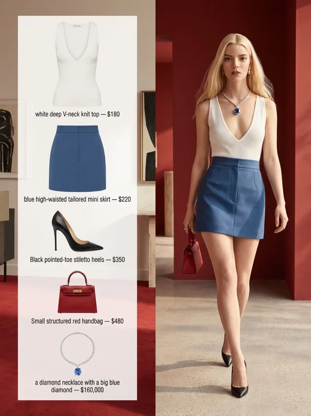</a><br><strong>穿搭单品与上身效果编辑页</strong><br><a href="https://x.com/craftian_keskin/status/2009665973058515294">Keskin · 原始来源 ↗</a></td></tr>
<tr><td><strong>表情包与贴纸</strong></td><td align="center">1 组</td><td><a href="https://biletian.github.io/ai-visual-atlas-preview/#work=2118156092865994837"></a><br><strong>橘猫打工人十二连表情</strong><br><a href="https://x.com/karanwithai/status/2118156092865994837">零点 Drift · 原始来源 ↗</a></td></tr>
<tr><td><strong>海报设计</strong></td><td align="center">1 组</td><td><a href="https://biletian.github.io/ai-visual-atlas-preview/#work=2120469968060043639">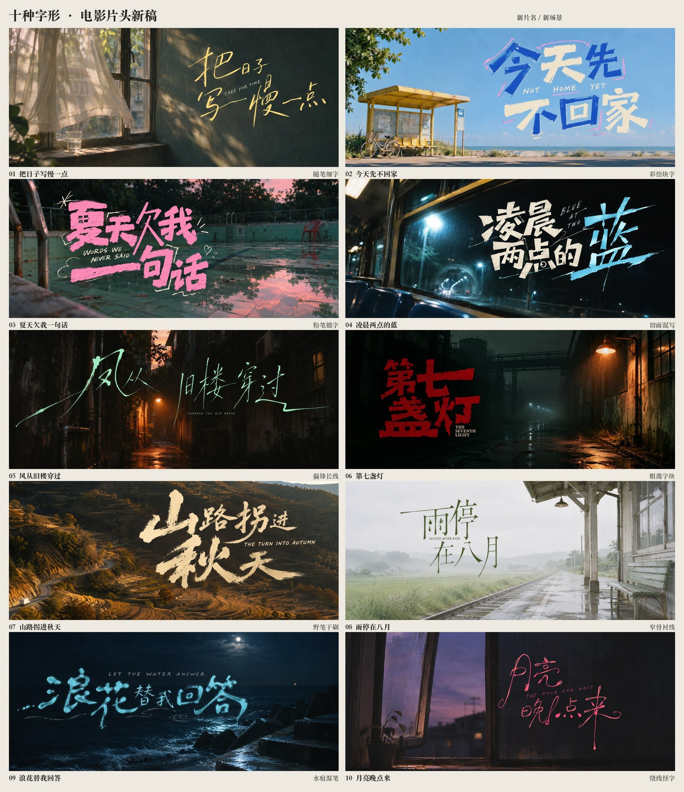</a><br><strong>中文标题设计系统</strong><br><a href="https://x.com/Leviwoyun/status/2120469968060043639">Levi 卧云 · 原始来源 ↗</a></td></tr>
<tr><td><strong>模型对比</strong></td><td align="center">1 组</td><td><a href="https://biletian.github.io/ai-visual-atlas-preview/#work=2118381855166881928">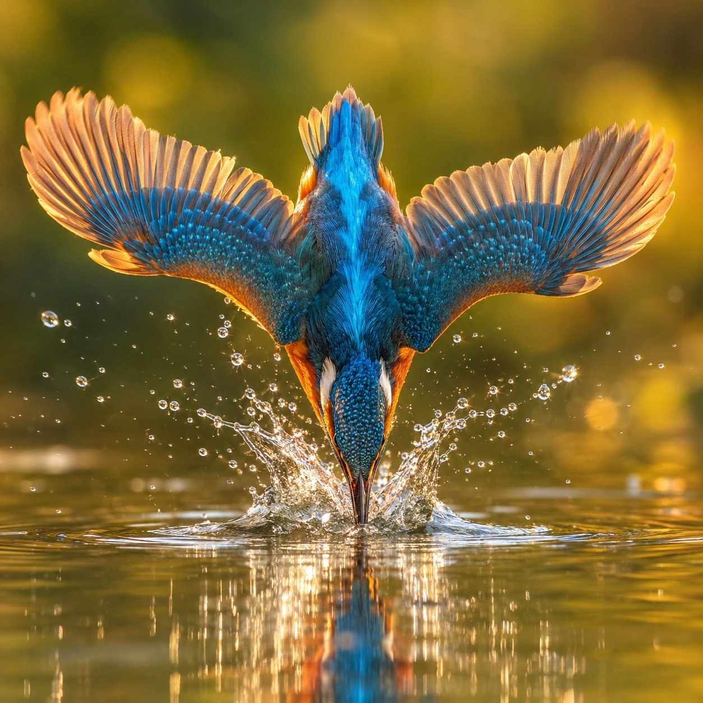</a><br><strong>翠鸟入水摄影对比</strong><br><a href="https://x.com/NovaXCode/status/2118381855166881928">Nova · 原始来源 ↗</a></td></tr>
<tr><td><strong>地图设计</strong></td><td align="center">1 组</td><td><a href="https://biletian.github.io/ai-visual-atlas-preview/#work=2119841736679686222"></a><br><strong>特拉维夫等轴测插画地图</strong><br><a href="https://x.com/DmytroKrasun/status/2119841736679686222">Dmytro Krasun · 原始来源 ↗</a></td></tr>
<tr><td><strong>角色与科幻</strong></td><td align="center">1 组</td><td><a href="https://biletian.github.io/ai-visual-atlas-preview/#work=2086559615878082837">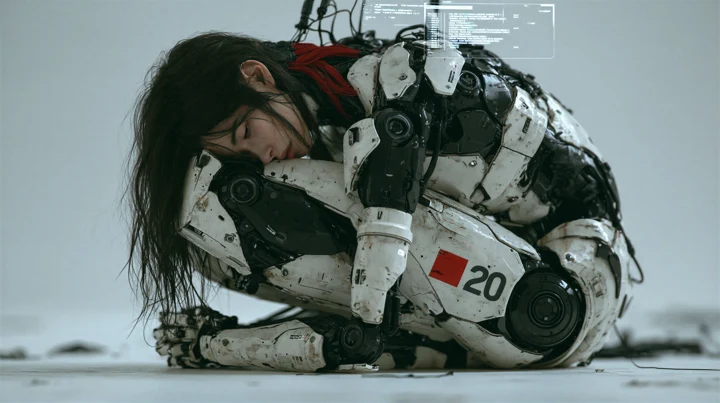</a><br><strong>蜷缩的装甲人形</strong><br><a href="https://x.com/MO_IAI/status/2086559615878082837">MO · 原始来源 ↗</a></td></tr>
<tr><td><strong>产品与平面设计</strong></td><td align="center">1 组</td><td><a href="https://biletian.github.io/ai-visual-atlas-preview/#work=2064020126937039318"></a><br><strong>折纸料理的结构海报</strong><br><a href="https://x.com/Gdgtify/status/2064020126937039318">Gadgetify · 原始来源 ↗</a></td></tr>
<tr><td><strong>动画短片</strong></td><td align="center">1 组</td><td><a href="https://biletian.github.io/ai-visual-atlas-preview/#work=2021412306291392535">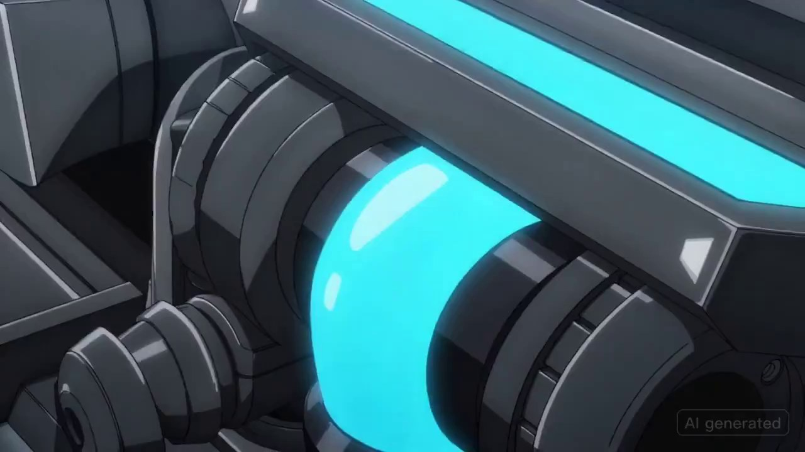</a><br><strong>水獭机甲迎战大理石章鱼</strong><br><a href="https://x.com/emollick/status/2021412306291392535">Ethan Mollick · 原始来源 ↗</a></td></tr>
<tr><td><strong>合计</strong></td><td align="center"><strong>405 组</strong></td><td>每个分类各展示 1 个实例，不是该分类的全部作品。</td></tr>
</table>

## 关于 Atlas · 图文导览

## 在 Atlas 里能找到什么

<table>
<tr><th>你可以做什么</th><th>对应作品与入口</th></tr>
<tr><td width="60%" valign="top"><h3>寻找视觉方向</h3><p>按创作主题浏览海报、品牌、产品、插画、建筑、材质与短片等作品。</p></td><td width="40%"><a href="https://biletian.github.io/ai-visual-atlas-preview/#work=2049022501850915160"></a><br><strong>跃起的运动鞋广告</strong><br><a href="https://x.com/Ozayrr_irl/status/2049022501850915160">Ozair AI · 原始来源 ↗</a></td></tr>
<tr><td width="60%" valign="top"><h3>看不同模型的创作案例</h3><p>按模型筛选；模型名称按来源记录，不把推荐模型写成原始模型。</p></td><td width="40%"><a href="https://biletian.github.io/ai-visual-atlas-preview/#work=recraft-v41pro-marine-earring"></a><br><strong>深海生物形态的树脂耳饰</strong><br><a href="https://recraft.ai/blog/testing-recraft-v4-1-and-krea-2">Recraft 官方 · 原始来源 ↗</a></td></tr>
<tr><td width="60%" valign="top"><h3>理解作品怎么做</h3><p>查看作者公开的提示词、参考材料和来源；缺失内容不补造。</p></td><td width="40%"><a href="https://biletian.github.io/ai-visual-atlas-preview/#work=2003849647392247864"></a><br><strong>从工程图到电影感展板</strong><br><a href="https://x.com/AllaAisling/status/2003849647392247864">Alexandra Aisling · 原始来源 ↗</a></td></tr>
<tr><td width="60%" valign="top"><h3>查看系列与过程</h3><p>在详情里切换组图或多段视频，再回到画廊继续浏览。</p></td><td width="40%"><a href="https://biletian.github.io/ai-visual-atlas-preview/#work=runway-gen45-fox"></a><br><strong>草帽狐狸的乡间摩托旅行</strong><br><a href="https://runway.com/research/introducing-runway-gen-4.5">Runway 官方 · 原始来源 ↗</a></td></tr>
<tr><td width="60%" valign="top"><h3>保存感兴趣的作品</h3><p>使用浏览器本地收藏；无需账号，不上传收藏记录。</p></td><td width="40%"><a href="https://biletian.github.io/ai-visual-atlas-preview/#work=2007087774248439879"></a><br><strong>丝带上的四座城市</strong><br><a href="https://x.com/aleenaamiir/status/2007087774248439879">Aleena Amir · 原始来源 ↗</a></td></tr>
<tr><td width="60%" valign="top"><h3>找回原作者</h3><p>通过作者与原帖链接继续查看完整语境。</p></td><td width="40%"><a href="https://biletian.github.io/ai-visual-atlas-preview/#work=recraft-v4-crimson-icons"></a><br><strong>四个酒红色超现实角色图标</strong><br><a href="https://recraft.ai/blog/prompt-engineering-guide">Anna Abdulina / Recraft · 原始来源 ↗</a></td></tr>
</table>

**收录快照：2026-11-16 核验时，首页精选为 405 组。** 组图按一组计，不等于图片数量；后续数量以[在线画廊](https://biletian.github.io/ai-visual-atlas-preview/)为准。数据中的候选与历史归档不等于当前公开精选。

## 我们如何收录

**发现 → 去重 → 核对出处 → 检查媒体与提示词 → 精选展示 → 持续纠错**

- 优先有原始发布记录、明确作者和可核对媒体的作品，兼顾不同作者、模型与视觉方向。
- 保留完整提示词、模板、摘录或未公开等实际状态；需要参考图的案例注明前提，不承诺一键复现。
- 模型、日期与创作说明依据来源记录，创作者的说法不等于本站独立测评结论。
- 尊重原作者的转载限制，不收录明确禁止转载的作品；开放许可按其条件保留署名和声明。
- 图片和视频中的品牌、人物与场景属于作品内容，不代表 Atlas 的合作、背书或真实事件记录。

发现错误或希望调整展示？请使用[纠错与权利反馈](https://github.com/biletian/ai-visual-atlas-preview/issues/new?template=correction.yml)。请只填写必要的公开信息，不在公开 Issue 上传证件、私人联系方式或其他敏感资料。

## 参与整理

欢迎推荐自己的作品或有清晰出处的优秀案例，也欢迎修正作者、模型、提示词和失效链接。

1. 通过[作品推荐表单](https://github.com/biletian/ai-visual-atlas-preview/issues/new?template=submit-work.yml)提供原帖、作者、模型及公开提示词。
2. 说明你与作品的关系和展示许可；推荐不代表自动收录。
3. 代码或数据修改请先阅读 [CONTRIBUTING.md](CONTRIBUTING.md)，保持原始来源及许可信息。


<details>
<summary><strong>开发与维护：本地运行、验证和部署</strong></summary>

## 本地运行

网站使用原生 HTML / CSS / JavaScript。运行已生成的静态文件无需前端打包器；从仓库重建完整公开目录需要 Python、Node.js 与 Pillow，且媒体核验会访问来源或已有发布副本。

```sh
python -m pip install Pillow==13.0.0
python scripts/build-curation.py
python scripts/sync-data.py
python scripts/build-catalog.py
python -m http.server 8080 --directory dist
```

打开 `http://localhost:8080`。`dist/cases.json` 只是基底，公开内容还由 `scripts/content-batch*.json` 等批次文件扩展，不能只编辑或统计基底后声称已更新全站。


```text
dist/                   静态网站、基底数据与已存媒体
scripts/                内容/媒体批次、重建与验证脚本
docs/                   核验记录、交互与构建说明
tests/                  分类、组图、视频、链接等检查
.github/workflows/      GitHub Pages 发布流程
```

```sh
node --check dist/app.js
node --check dist/ui.js
node scripts/verify-gallery.cjs
node tests/avatar.cjs
node tests/image-gallery.cjs
```

`main` 更新触发 [Deploy Visual Atlas](.github/workflows/pages.yml)：重建并核验媒体与目录，通过后发布 `dist/`。详情参考[内容构建](docs/content-build.md)、[组图说明](docs/image-gallery.md)与[组件和动效](docs/components-motion.md)。

列表采用增量加载，完整提示词和组图详情按需加载；视频减少离屏预加载，切后台暂停。实际访问速度仍受网络与第三方来源影响。


</details>

## 来源、许可与隐私

<table><tr><td width="65%" valign="top">
<ul><li><strong>收录不等于授权再分发。</strong> 作品、提示词、头像与商标分别遵循原权利人的许可或限制。公开可访问、附带原帖链接或标记为可展示，不等于获得开放许可证或商用授权。</li><li><code>owner-directed-display</code> 是项目内的展示记录，不是作者授予的开放许可。使用作品前请回到原始来源核对条款，必要时联系原作者。</li><li>CC BY 4.0 素材保留署名、来源、许可及转码说明，见 <a href="dist/assets/ailingqu/ATTRIBUTION.txt">ailingqu 署名</a>与<a href="dist/assets/ailingqu/LICENSE">许可</a>。转码和缩略图不改变原始权属。</li><li>图标与历史集成依赖分别见 <a href="LUCIDE-LICENSE">LUCIDE-LICENSE</a> 和 <a href="HEROUI-LICENSE">HEROUI-LICENSE</a>。这些第三方许可证<strong>不代表整个作品库统一采用同一许可证</strong>。</li><li>收藏仅保存在当前浏览器。第三方媒体与原帖请求可能受到网络限制；跳转后的站点适用其自身规则。</li></ul>
</td><td width="35%" valign="top"><a href="https://biletian.github.io/ai-visual-atlas-preview/#work=recraft-v41pro-marine-earring"></a><br><strong>深海生物形态的树脂耳饰</strong><br><a href="https://recraft.ai/blog/testing-recraft-v4-1-and-krea-2">Recraft 官方 · 原始来源 ↗</a><p><sub>示例由原作者或官方来源创作。查看原始来源了解具体使用条件；本页展示不提供额外商用授权。</sub></p></td></tr></table>

## English

<table><tr><td width="60%" valign="top">
<p><strong>Atlas is a curated collection of AI-generated images and videos, not an original portfolio or an image-generation service.</strong> Explore works by theme or model, inspect publicly shared prompts and references, and follow the credits back to the original creators.</p>
<p>The gallery includes images, animations, image sets and video examples. Availability of a prompt does not guarantee identical results. Attribution does not grant reuse rights: each work keeps its original license or restrictions.</p>
<p><a href="https://biletian.github.io/ai-visual-atlas-preview/">Explore the gallery</a> · <a href="CONTRIBUTING.md">Contribute a work</a> · <a href="https://github.com/biletian/ai-visual-atlas-preview/issues/new?template=correction.yml">Report a correction</a></p>
</td><td width="40%" valign="top"><a href="https://biletian.github.io/ai-visual-atlas-preview/#work=2007087774248439879"></a><br><strong>丝带上的四座城市</strong><br><a href="https://x.com/aleenaamiir/status/2007087774248439879">Aleena Amir · 原始来源 ↗</a></td></tr></table>

<div align="center">

[](https://github.com/biletian/ai-visual-atlas-preview/actions/workflows/pages.yml)
[](https://github.com/biletian/ai-visual-atlas-preview/stargazers)
[](https://github.com/biletian/ai-visual-atlas-preview/commits/main/)

<sub>作品属于创作者。Atlas 让发现它们更容易。</sub>

</div>
