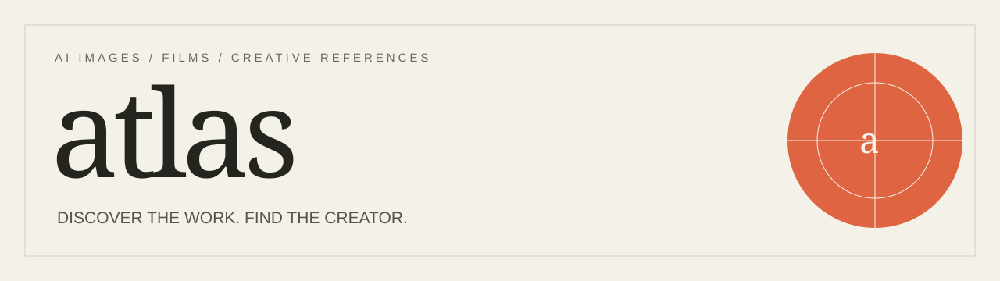
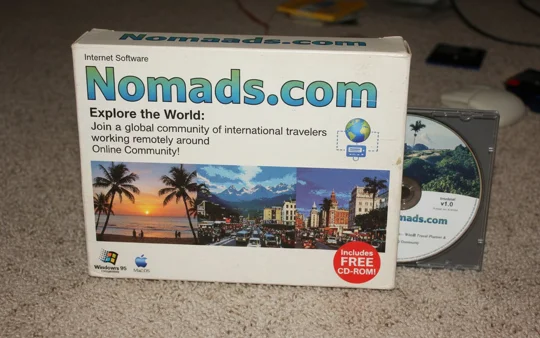
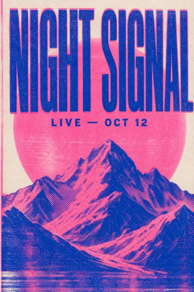

<div align="center">

<a href="https://biletian.github.io/ai-visual-atlas-preview/"></a>

# Atlas · AI 影像灵感库

**精选收录 AI 图像与视频作品，把灵感、作者、原帖和公开提示词放在一起。**

[浏览作品 ↗](https://biletian.github.io/ai-visual-atlas-preview/) · [推荐作品](https://github.com/biletian/ai-visual-atlas-preview/issues/new?template=submit-work.yml) · [纠错与权利反馈](https://github.com/biletian/ai-visual-atlas-preview/issues/new?template=correction.yml) · [English](#english)

[](https://github.com/biletian/ai-visual-atlas-preview/actions/workflows/pages.yml)
[](https://github.com/biletian/ai-visual-atlas-preview/stargazers)
[](https://github.com/biletian/ai-visual-atlas-preview/commits/main/)

</div>

> **这是作品收录与浏览项目，不是 Atlas 的原创作品集，也不是 AI 生成工具。** 图片、视频与提示词来自各自创作者或官方来源，相关权利归原权利人；Atlas 负责筛选、整理与展示。

## 从作品开始

点击图片进入作品详情，点击署名回到原始来源。这里展示的是已收录作品，不是界面占位图。

<table>
<tr>
<td width="33%" valign="top"><a href="https://biletian.github.io/ai-visual-atlas-preview/#work=1967593100676943892"></a><br><strong>把网站装进1995年软件盒</strong><br><sub>品牌与广告 · Nano Banana</sub><br><a href="https://x.com/levelsio/status/1967593100676943892">@levelsio · 原始来源 ↗</a></td>
<td width="33%" valign="top"><a href="https://biletian.github.io/ai-visual-atlas-preview/#work=2001932788023595077"></a><br><strong>黑色透明产品材质板</strong><br><sub>材质与工艺 · Nano Banana</sub><br><a href="https://x.com/azed_ai/status/2001932788023595077">Amira Zairi · 原始来源 ↗</a></td>
<td width="33%" valign="top"><a href="https://biletian.github.io/ai-visual-atlas-preview/#work=2005659825028649109"></a><br><strong>从羊皮纸升起的文明地图</strong><br><sub>微缩与超现实 · Nano Banana</sub><br><a href="https://x.com/AllaAisling/status/2005659825028649109">Alexandra Aisling · 原始来源 ↗</a></td>
</tr>
<tr>
<td width="33%" valign="top"><a href="https://biletian.github.io/ai-visual-atlas-preview/#work=shuryne-riso-concert-poster"></a><br><strong>双色 Riso 演出海报</strong><br><sub>海报与排版 · GPT Image</sub><br><a href="https://github.com/Shuryne/gpt-image-prompts/blob/main/prompts/riso-concert-poster.md">Shuryne · 原始来源 ↗</a></td>
<td width="33%" valign="top"><a href="https://biletian.github.io/ai-visual-atlas-preview/#work=shuryne-gouache-rainy-tram-stop"></a><br><strong>雨夜电车站水粉</strong><br><sub>插画与角色 · GPT Image</sub><br><a href="https://github.com/Shuryne/gpt-image-prompts/blob/main/prompts/gouache-rainy-tram-stop.md">Shuryne · 原始来源 ↗</a></td>
<td width="33%" valign="top"><a href="https://biletian.github.io/ai-visual-atlas-preview/#work=runway-gen45-fox"></a><br><strong>草帽狐狸的乡间摩托旅行</strong><br><sub>短片与镜头 · Runway Gen-4.5</sub><br><a href="https://runway.com/research/introducing-runway-gen-4.5">Runway 官方 · 原始来源 ↗</a></td>
</tr>
</table>

*以上预览复用站内已有媒体；视频以封面展示，点击后播放。Shuryne 示例的 MIT 许可及版权声明见[原许可](dist/licenses/shuryne-MIT.txt)。其他作品不因此获得统一开放许可。*

## 在 Atlas 里能找到什么

| 想做的事 | 怎么浏览 |
| --- | --- |
| 寻找视觉方向 | 按创作主题浏览海报、品牌、产品、插画、建筑、材质与短片等作品 |
| 看不同模型的创作案例 | 按模型筛选；模型名称按来源记录，不把推荐模型写成原始模型 |
| 理解作品怎么做 | 查看作者公开的提示词、参考材料和来源；缺失内容不补造 |
| 查看系列与过程 | 在详情里切换组图或多段视频，再回到画廊继续浏览 |
| 保存感兴趣的作品 | 使用浏览器本地收藏；无需账号，不上传收藏记录 |
| 找回原作者 | 通过作者与原帖链接继续查看完整语境 |

**收录快照：2026-11-16 核验时，首页精选为 403 组。** 组图按一组计，不等于图片数量；后续数量以[在线画廊](https://biletian.github.io/ai-visual-atlas-preview/)为准。数据中的候选与历史归档不等于当前公开精选。

## 我们如何收录

**发现 → 去重 → 核对出处 → 检查媒体与提示词 → 精选展示 → 持续纠错**

- 优先有原始发布记录、明确作者和可核对媒体的作品，兼顾不同作者、模型与视觉方向。
- 保留完整提示词、模板、摘录或未公开等实际状态；需要参考图的案例注明前提，不承诺一键复现。
- 模型、日期与创作说明依据来源记录，创作者的说法不等于本站独立测评结论。
- 尊重原作者的转载限制，不收录明确禁止转载的作品；开放许可按其条件保留署名和声明。
- 图片和视频中的品牌、人物与场景属于作品内容，不代表 Atlas 的合作、背书或真实事件记录。

发现错误或希望调整展示？请使用[纠错与权利反馈](https://github.com/biletian/ai-visual-atlas-preview/issues/new?template=correction.yml)。请只填写必要的公开信息，不在公开 Issue 上传证件、私人联系方式或其他敏感资料。

## 参与整理

欢迎推荐自己的作品或有清晰出处的优秀案例，也欢迎修正作者、模型、提示词和失效链接。

1. 通过[作品推荐表单](https://github.com/biletian/ai-visual-atlas-preview/issues/new?template=submit-work.yml)提供原帖、作者、模型及公开提示词。
2. 说明你与作品的关系和展示许可；推荐不代表自动收录。
3. 代码或数据修改请先阅读 [CONTRIBUTING.md](CONTRIBUTING.md)，保持原始来源及许可信息。

## 本地运行

网站使用原生 HTML / CSS / JavaScript。运行已生成的静态文件无需前端打包器；从仓库重建完整公开目录需要 Python、Node.js 与 Pillow，且媒体核验会访问来源或已有发布副本。

```sh
python -m pip install Pillow==13.0.0
python scripts/build-curation.py
python scripts/sync-data.py
python scripts/build-catalog.py
python -m http.server 8080 --directory dist
```

打开 `http://localhost:8080`。`dist/cases.json` 只是基底，公开内容还由 `scripts/content-batch*.json` 等批次文件扩展，不能只编辑或统计基底后声称已更新全站。

<details>
<summary><strong>维护者：目录、验证与部署</strong></summary>

```text
dist/                   静态网站、基底数据与已存媒体
scripts/                内容/媒体批次、重建与验证脚本
docs/                   核验记录、交互与构建说明
tests/                  分类、组图、视频、链接等检查
.github/workflows/      GitHub Pages 发布流程
```

```sh
node --check dist/app.js
node --check dist/ui.js
node scripts/verify-gallery.cjs
node tests/avatar.cjs
node tests/image-gallery.cjs
```

`main` 更新触发 [Deploy Visual Atlas](.github/workflows/pages.yml)：重建并核验媒体与目录，通过后发布 `dist/`。详情参考[内容构建](docs/content-build.md)、[组图说明](docs/image-gallery.md)与[组件和动效](docs/components-motion.md)。

列表采用增量加载，完整提示词和组图详情按需加载；视频减少离屏预加载，切后台暂停。实际访问速度仍受网络与第三方来源影响。

</details>

## 来源、许可与隐私

- **收录不等于授权再分发。** 作品、提示词、头像与商标分别遵循原权利人的许可或限制。公开可访问、附带原帖链接或标记为可展示，不等于获得开放许可证或商用授权。
- `owner-directed-display` 是项目内的展示记录，不是作者授予的开放许可。使用作品前请回到原始来源核对条款，必要时联系原作者。
- CC BY 4.0 素材保留署名、来源、许可及转码说明，见 [ailingqu 署名](dist/assets/ailingqu/ATTRIBUTION.txt)与[许可](dist/assets/ailingqu/LICENSE)。转码和缩略图不改变原始权属。
- 图标与历史集成依赖分别见 [LUCIDE-LICENSE](LUCIDE-LICENSE) 和 [HEROUI-LICENSE](HEROUI-LICENSE)。这些第三方许可证**不代表整个作品库统一采用同一许可证**。
- 收藏仅保存在当前浏览器。第三方媒体与原帖请求可能受到网络限制；跳转后的站点适用其自身规则。

## English

**Atlas is a curated collection of AI-generated images and videos, not an original portfolio or an image-generation service.** Explore works by theme or model, inspect publicly shared prompts and references, and follow the credits back to the original creators.

The gallery includes images, animations, image sets and video examples. Availability of a prompt does not guarantee identical results. Attribution does not grant reuse rights: each work keeps its original license or restrictions.

[Explore the gallery](https://biletian.github.io/ai-visual-atlas-preview/) · [Contribute a work](CONTRIBUTING.md) · [Report a correction](https://github.com/biletian/ai-visual-atlas-preview/issues/new?template=correction.yml)

---

<div align="center"><sub>看见好作品，也看见作品背后的创作者。</sub></div>
